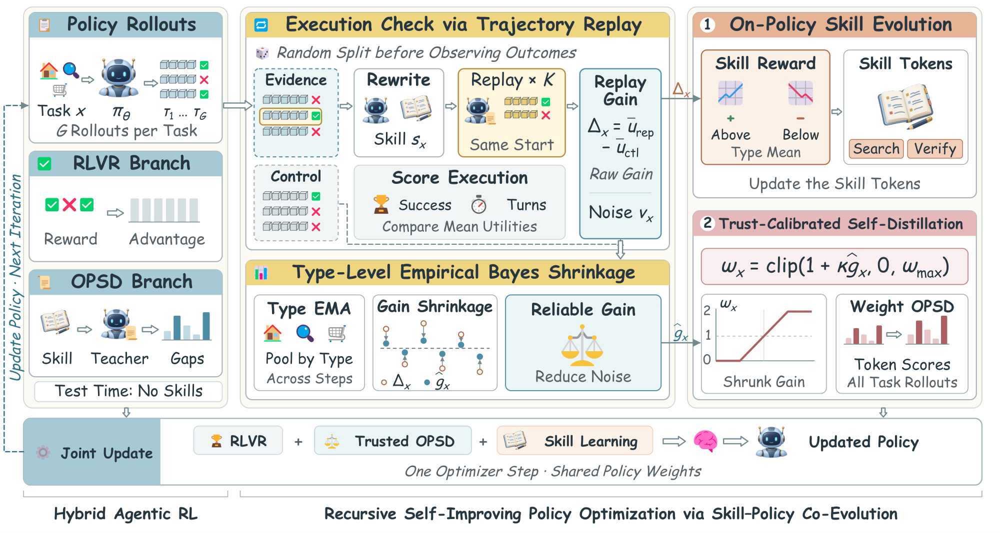
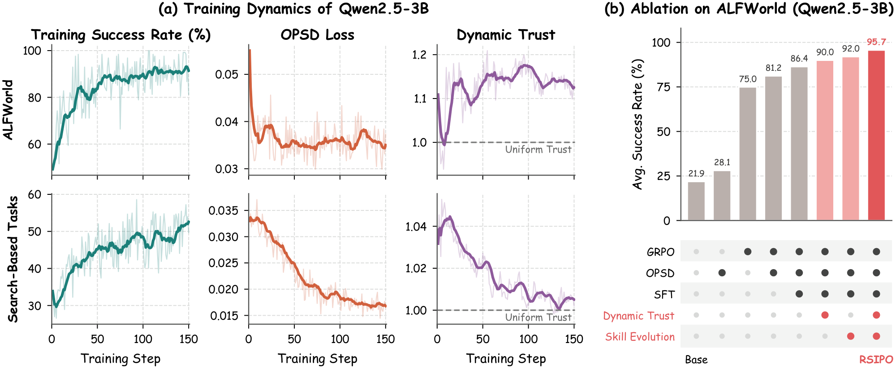
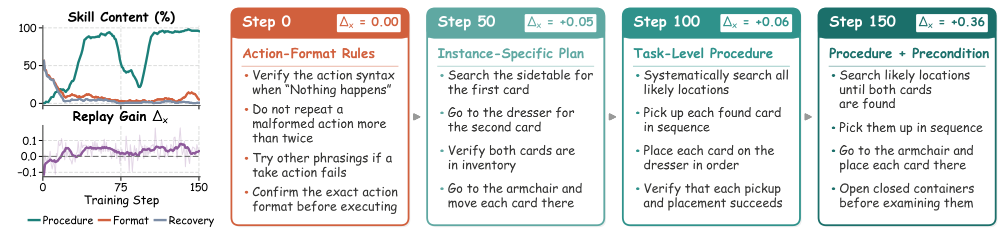
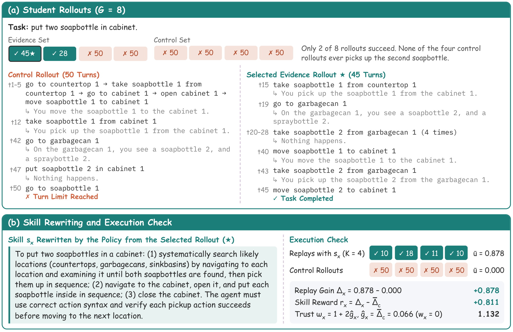
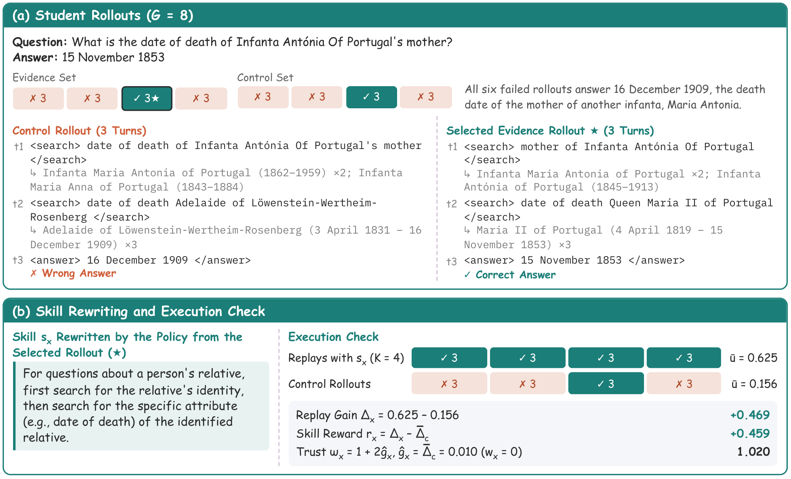

# RSIPO: Recursive Self-Improving Policy Optimization for Agentic Reinforcement Learning via Skill-Policy Co-Evolution

<p align="center">
  
  <a href="#-checkpoints"></a>
  
  
  
</p>

RSIPO is a self-evolving agentic RL framework in which agentic skills and the policy co-evolve during training. It
builds on the hybrid of RLVR and on-policy self-distillation (OPSD) in [SEED](https://jinyangwu.github.io/seed/),
where the policy summarizes its own trajectories into skills and a skill-enhanced copy of the policy acts as the
teacher.

## 📰 News

- **[2026.10]** We released the code and the RSIPO checkpoints of Qwen2.5-7B-Instruct, Qwen3-1.7B and
  Qwen2.5-3B-Instruct on ALFWorld and search-based QA [[🤗 Models](#-checkpoints)].

## 🏗️ Overview

<p align="center">
  
</p>

<p align="left"><b>Figure 1.</b> Overview of the RSIPO framework. Replay gains measured by the execution check reward
on-policy skill generation and calibrate the student's trust in the skill-enhanced teacher.</p>

RSIPO adds an **execution check**: for every training task, the policy rewrites a skill from one of its rollouts, the
skill-enhanced teacher replays the task from the same initial state, and the replays are compared with control
rollouts of the student. The measured replay gains are used twice:

1. **On-policy skill evolution.** The gain, centered by the mean gain of the task type, rewards the skill the policy
   wrote, so skill generation is optimized on-policy together with task execution.
2. **Trust-calibrated self-distillation.** The gain, shrunk towards its task-type mean with empirical Bayes, sets the
   weight of the OPSD loss of the task, so the student follows the teacher only as far as the teacher helps.

No skill is used at test time.

## 📊 Main Results

RSIPO is compared with 13 baselines on ALFWorld and seven search-based QA datasets with three base models. It achieves
the best average success rate on ALFWorld with all three base models and the best average exact match on search-based
QA with Qwen2.5-7B-Instruct and Qwen3-1.7B; with Qwen2.5-3B-Instruct it ranks second on search-based QA, 0.4 points
below SEED.

<!-- results:begin -->
| Method | Qwen2.5-7B<br>ALFWorld | Qwen2.5-7B<br>Search | Qwen3-1.7B<br>ALFWorld | Qwen3-1.7B<br>Search | Qwen2.5-3B<br>ALFWorld | Qwen2.5-3B<br>Search |
| --- | ---: | ---: | ---: | ---: | ---: | ---: |
| Vanilla | 12.5 | 33.9 | 12.5 | 24.8 | 21.9 | 31.7 |
| Skill-Prompt\* | 23.4 | 36.4 | 9.4 | 24.3 | 28.9 | 23.9 |
| OPSD | 32.8 | 6.2 | 14.1 | 5.8 | 28.1 | 0.0 |
| GRPO | 81.2 | 42.0 | 46.1 | 40.8 | 75.0 | 36.4 |
| Skill-GRPO | 69.5 | 40.3 | 21.1 | 40.4 | 60.2 | 34.1 |
| Skill-GRPO\* | 88.3 | 47.5 | 28.1 | 40.7 | 80.5 | 36.1 |
| GRPO+OPSD | 80.4 | 47.0 | 32.0 | <ins>42.2</ins> | 81.2 | 44.6 |
| Skill-SD | 85.1 | 47.8 | 52.3 | 40.8 | 73.4 | 44.1 |
| RLSD | 82.0 | 49.0 | 42.2 | 40.6 | 79.7 | 43.8 |
| SDAR | 85.9 | 49.0 | 53.9 | 41.9 | 84.4 | 43.4 |
| StepOPSD | 88.4 | 48.2 | 56.3 | 41.4 | 73.4 | 43.7 |
| OPID | 90.0 | <ins>49.2</ins> | 58.9 | 40.4 | 84.3 | 45.0 |
| SEED | <ins>96.1</ins> | 48.6 | <ins>92.0</ins> | <ins>42.2</ins> | <ins>91.8</ins> | **45.7** |
| **RSIPO** | **98.6** | **50.8** | **95.0** | **42.6** | **95.7** | <ins>45.3</ins> |

ALFWorld: success rate (%). Search: exact match (%) averaged over the seven datasets. Methods marked with \* use skills at test time. Within each column, the best result is in **bold** and the second best is <ins>underlined</ins>.

<details>
<summary><b>Full results with Qwen2.5-7B-Instruct</b> (Table 1 of the paper)</summary>

**ALFWorld**

| Method | Pick | Look | Clean | Heat | Cool | Pick2 | Avg |
| --- | ---: | ---: | ---: | ---: | ---: | ---: | ---: |
| Vanilla | 36.1 | 22.2 | 3.1 | 0.0 | 0.0 | 0.0 | 12.5 |
| Skill-Prompt\* | 51.7 | 50.0 | 32.3 | 5.3 | 4.3 | 0.0 | 23.4 |
| OPSD | 50.0 | 60.0 | 22.7 | 21.4 | 17.6 | 9.5 | 32.8 |
| GRPO | 91.2 | 87.5 | 96.2 | 81.0 | 65.0 | 57.9 | 81.2 |
| Skill-GRPO | 88.5 | 66.7 | 65.2 | 61.1 | 57.7 | 73.1 | 69.5 |
| Skill-GRPO\* | **100.0** | 83.3 | 96.4 | 83.3 | 75.0 | 78.9 | 88.3 |
| GRPO+OPSD | 91.4 | 61.5 | **100.0** | 87.5 | 76.5 | 52.2 | 80.4 |
| Skill-SD | 93.9 | <ins>93.8</ins> | 90.9 | **100.0** | 69.2 | 68.4 | 85.1 |
| RLSD | **100.0** | 87.5 | 92.3 | 58.8 | 80.0 | 65.2 | 82.0 |
| SDAR | 94.7 | 75.0 | **100.0** | 86.7 | 68.2 | 78.9 | 85.9 |
| StepOPSD | <ins>98.1</ins> | 75.0 | **100.0** | <ins>90.5</ins> | 80.0 | 63.2 | 88.4 |
| OPID | **100.0** | 81.8 | <ins>97.1</ins> | **100.0** | 80.8 | <ins>80.0</ins> | 90.0 |
| SEED | **100.0** | **100.0** | 96.3 | 80.0 | **100.0** | **100.0** | <ins>96.1</ins> |
| **RSIPO** | **100.0** | **100.0** | 96.3 | **100.0** | <ins>96.0</ins> | **100.0** | **98.6** |

**Search-based QA**

| Method | NQ | TriviaQA | PopQA | HotpotQA | 2Wiki | MuSiQue | Bamboogle | Avg |
| --- | ---: | ---: | ---: | ---: | ---: | ---: | ---: | ---: |
| Vanilla | 25.2 | 50.8 | 29.5 | 29.0 | 29.0 | 10.4 | 63.7 | 33.9 |
| Skill-Prompt\* | 30.9 | 52.1 | 32.7 | 32.7 | 27.9 | 12.7 | 66.1 | 36.4 |
| OPSD | 8.8 | 8.6 | 17.5 | 2.5 | 4.2 | 0.5 | 1.2 | 6.2 |
| GRPO | 45.1 | 63.7 | 44.0 | 43.6 | 43.2 | 16.8 | 37.6 | 42.0 |
| Skill-GRPO | 45.2 | 63.7 | 45.7 | 43.1 | 43.3 | 19.6 | 21.4 | 40.3 |
| Skill-GRPO\* | 44.8 | 63.0 | 45.1 | 43.7 | 43.7 | 20.5 | 71.4 | 47.5 |
| GRPO+OPSD | <ins>47.3</ins> | 64.5 | 46.9 | 43.8 | 39.3 | 18.0 | 69.4 | 47.0 |
| Skill-SD | 47.1 | 64.5 | 47.8 | 44.2 | 42.1 | 20.2 | 69.0 | 47.8 |
| RLSD | 46.8 | 63.0 | 44.4 | <ins>45.5</ins> | <ins>48.9</ins> | <ins>21.5</ins> | <ins>73.0</ins> | 49.0 |
| SDAR | 46.3 | 63.5 | <ins>48.2</ins> | 43.8 | 48.4 | 19.6 | <ins>73.0</ins> | 49.0 |
| StepOPSD | 45.3 | 64.6 | 45.1 | 44.5 | 44.4 | 19.3 | 69.8 | 48.2 |
| OPID | **48.8** | <ins>65.6</ins> | 46.8 | **46.1** | 42.7 | **21.7** | 72.6 | <ins>49.2</ins> |
| SEED | 47.0 | 64.9 | 47.8 | 45.2 | 45.3 | 20.1 | 70.2 | 48.6 |
| **RSIPO** | 46.8 | **67.8** | **49.1** | 45.3 | **52.1** | 20.8 | **73.8** | **50.8** |

</details>

<details>
<summary><b>Full results with Qwen3-1.7B</b> (Table 1 of the paper)</summary>

**ALFWorld**

| Method | Pick | Look | Clean | Heat | Cool | Pick2 | Avg |
| --- | ---: | ---: | ---: | ---: | ---: | ---: | ---: |
| Vanilla | 25.0 | 22.2 | 3.1 | 0.0 | 21.4 | 4.2 | 12.5 |
| Skill-Prompt\* | 10.3 | 50.0 | 16.1 | 0.0 | 0.0 | 5.0 | 9.4 |
| OPSD | 26.3 | 33.3 | 9.1 | 0.0 | 4.5 | 5.3 | 14.1 |
| GRPO | 71.1 | 41.7 | 36.4 | 40.0 | 31.8 | 31.6 | 46.1 |
| Skill-GRPO | 27.6 | 54.5 | 22.7 | 27.3 | 0.0 | 19.2 | 21.1 |
| Skill-GRPO\* | 31.4 | 42.9 | 51.9 | 8.3 | 11.5 | 7.1 | 28.1 |
| GRPO+OPSD | 38.2 | 50.0 | 30.8 | 28.6 | 30.0 | 21.1 | 32.0 |
| Skill-SD | 52.9 | 37.5 | 69.2 | 42.9 | 60.0 | 36.8 | 52.3 |
| RLSD | 50.0 | 37.5 | 61.5 | 19.0 | 50.0 | 21.1 | 42.2 |
| SDAR | 73.5 | 25.0 | 76.9 | 33.3 | 40.0 | 36.8 | 53.9 |
| StepOPSD | 64.7 | 44.4 | 56.5 | 60.9 | 42.1 | 55.0 | 56.3 |
| OPID | 65.9 | <ins>72.7</ins> | 66.7 | 40.0 | 63.2 | 45.0 | 58.9 |
| SEED | <ins>97.6</ins> | **100.0** | **100.0** | <ins>80.0</ins> | <ins>84.2</ins> | **90.0** | <ins>92.0</ins> |
| **RSIPO** | **100.0** | **100.0** | <ins>96.3</ins> | **100.0** | **88.0** | <ins>87.5</ins> | **95.0** |

**Search-based QA**

| Method | NQ | TriviaQA | PopQA | HotpotQA | 2Wiki | MuSiQue | Bamboogle | Avg |
| --- | ---: | ---: | ---: | ---: | ---: | ---: | ---: | ---: |
| Vanilla | 29.4 | 46.9 | 37.0 | 23.5 | 19.6 | 6.4 | 10.5 | 24.8 |
| Skill-Prompt\* | 29.4 | 46.5 | 36.2 | 22.9 | 20.8 | 4.3 | 10.1 | 24.3 |
| OPSD | 4.2 | 8.3 | 4.6 | 6.6 | 15.3 | 0.7 | 1.2 | 5.8 |
| GRPO | 40.0 | **58.9** | 43.5 | 35.4 | 30.3 | 12.0 | 65.7 | 40.8 |
| Skill-GRPO | 39.2 | <ins>58.6</ins> | 43.9 | 35.2 | 28.2 | 11.5 | <ins>66.1</ins> | 40.4 |
| Skill-GRPO\* | 38.0 | 58.4 | 43.9 | 36.3 | 29.0 | 12.5 | **66.9** | 40.7 |
| GRPO+OPSD | <ins>40.7</ins> | **58.9** | 45.0 | **37.0** | 34.6 | **13.3** | 65.7 | <ins>42.2</ins> |
| Skill-SD | 39.1 | 57.5 | 45.4 | 34.8 | 34.1 | 10.7 | 64.1 | 40.8 |
| RLSD | 38.6 | 57.3 | 43.0 | 34.5 | 34.1 | 11.5 | 65.3 | 40.6 |
| SDAR | 39.7 | **58.9** | 45.3 | 35.9 | <ins>35.5</ins> | <ins>12.6</ins> | 65.3 | 41.9 |
| StepOPSD | 40.5 | <ins>58.6</ins> | 45.6 | 34.9 | 29.8 | 10.8 | 64.5 | 41.4 |
| OPID | 38.1 | 58.1 | 43.4 | 35.5 | 31.7 | 11.7 | 64.5 | 40.4 |
| SEED | **42.0** | **58.9** | <ins>47.1</ins> | <ins>36.9</ins> | 35.2 | 10.6 | 64.9 | <ins>42.2</ins> |
| **RSIPO** | 40.0 | 58.5 | **49.0** | 35.2 | **37.8** | <ins>12.6</ins> | 64.9 | **42.6** |

</details>

<details>
<summary><b>Full results with Qwen2.5-3B-Instruct</b> (Table 3 of the paper)</summary>

**ALFWorld**

| Method | Pick | Look | Clean | Heat | Cool | Pick2 | Avg |
| --- | ---: | ---: | ---: | ---: | ---: | ---: | ---: |
| Vanilla | 44.4 | 11.1 | 6.2 | 15.4 | 28.6 | 12.5 | 21.9 |
| Skill-Prompt\* | 51.7 | 66.7 | 48.4 | 0.0 | 4.3 | 10.0 | 28.9 |
| OPSD | 48.8 | 41.7 | 16.7 | 0.0 | 15.8 | 16.7 | 28.1 |
| GRPO | 91.2 | 62.5 | <ins>96.2</ins> | 61.9 | 65.0 | 47.4 | 75.0 |
| Skill-GRPO | 88.9 | 71.4 | 58.8 | 70.6 | 40.7 | 29.2 | 60.2 |
| Skill-GRPO\* | 94.3 | 57.1 | **100.0** | 66.7 | 73.1 | 57.1 | 80.5 |
| GRPO+OPSD | **100.0** | <ins>82.4</ins> | 85.7 | 75.0 | 70.0 | 60.0 | 81.2 |
| Skill-SD | 88.2 | 50.0 | <ins>96.2</ins> | 52.4 | 65.0 | 57.9 | 73.4 |
| RLSD | 87.9 | 75.0 | 90.9 | 75.0 | 73.1 | 68.4 | 79.7 |
| SDAR | <ins>97.1</ins> | 62.5 | **100.0** | 61.9 | 75.0 | <ins>84.2</ins> | 84.4 |
| StepOPSD | 82.4 | 66.7 | 82.6 | 52.2 | 73.7 | 75.0 | 73.4 |
| OPID | 92.7 | **100.0** | 88.9 | 70.0 | <ins>84.2</ins> | 70.0 | 84.3 |
| SEED | **100.0** | **100.0** | **100.0** | **100.0** | 70.6 | 80.0 | <ins>91.8</ins> |
| **RSIPO** | <ins>97.1</ins> | **100.0** | **100.0** | <ins>93.8</ins> | **92.0** | **91.7** | **95.7** |

**Search-based QA**

| Method | NQ | TriviaQA | PopQA | HotpotQA | 2Wiki | MuSiQue | Bamboogle | Avg |
| --- | ---: | ---: | ---: | ---: | ---: | ---: | ---: | ---: |
| Vanilla | 24.6 | 48.1 | 31.0 | 26.3 | 25.3 | 7.2 | 59.7 | 31.7 |
| Skill-Prompt\* | 23.7 | 46.2 | 30.6 | 24.4 | 22.1 | 7.5 | 12.5 | 23.9 |
| OPSD | 0.1 | 0.1 | 0.1 | 0.0 | 0.0 | 0.0 | 0.0 | 0.0 |
| GRPO | 39.3 | 60.6 | 41.1 | 37.4 | 34.6 | 15.4 | 26.4 | 36.4 |
| Skill-GRPO | 43.5 | 58.8 | 43.0 | 36.8 | 32.2 | 11.7 | 12.5 | 34.1 |
| Skill-GRPO\* | 44.3 | 59.6 | 44.3 | 39.0 | 36.1 | 14.5 | 14.9 | 36.1 |
| GRPO+OPSD | <ins>44.9</ins> | 61.2 | 45.2 | 40.4 | 38.5 | 16.0 | 66.1 | 44.6 |
| Skill-SD | 44.4 | 60.4 | 44.0 | 39.5 | 40.4 | 15.4 | 64.9 | 44.1 |
| RLSD | 41.5 | 58.6 | 42.3 | 40.4 | 40.2 | <ins>16.8</ins> | 66.9 | 43.8 |
| SDAR | 44.8 | 58.1 | 44.3 | 38.6 | 36.2 | 15.7 | 66.1 | 43.4 |
| StepOPSD | 43.6 | 61.2 | 43.8 | 39.2 | 38.1 | 15.8 | 64.5 | 43.7 |
| OPID | **45.9** | <ins>61.4</ins> | 45.7 | <ins>40.7</ins> | 38.8 | 16.4 | 66.1 | 45.0 |
| SEED | 44.3 | **61.9** | <ins>47.2</ins> | **41.0** | <ins>42.0</ins> | **16.9** | **67.7** | **45.7** |
| **RSIPO** | 39.0 | 61.1 | **49.8** | 39.6 | **43.2** | **16.9** | <ins>67.3</ins> | <ins>45.3</ins> |

</details>
<!-- results:end -->

## 🔍 Analysis

<p align="center">
  
</p>

<p align="left"><b>Figure 2.</b> (a) Training dynamics of RSIPO with Qwen2.5-3B-Instruct, where thick lines are 10-step
moving averages. (b) Ablation on ALFWorld with Qwen2.5-3B-Instruct, where dots mark the components of each variant.</p>

The dynamic trust tracks the reliability of the teacher: on ALFWorld it exceeds 1.1 within 20 steps as the
skill-enhanced teacher increasingly outperforms the control rollouts, and on search-based tasks, where the teacher
offers little extra benefit, it stays close to one. In the ablation, dynamic trust and skill evolution add 3.6 and 5.6
points to the hybrid pipeline with SFT initialization (86.4), and the full RSIPO reaches 95.7; removing either
component costs 3.7 to 5.7 points.

<p align="center">
  
</p>

<p align="left"><b>Figure 3.</b> On-policy skill evolution of Qwen2.5-7B-Instruct on ALFWorld. Left: skill content and
replay gain Δ<sub>x</sub>. Right: condensed skills for tasks that place two credit cards, where step 0 is the SFT
policy.</p>

Early skills inherited from SFT often concern action format or recovery from failed actions and have a negative
average replay gain. Procedure skills exceed 94% in the last 45 steps, and the replay gain turns positive.

<details>
<summary><b>Case studies:</b> helpful skills found by the execution check</summary>

<br>

✓ and ✗ mark successful and failed episodes with their numbers of turns, and ★ marks the selected evidence rollout.

<p align="center">
  
</p>

<p align="left"><b>Figure 4.</b> A helpful skill written by Qwen2.5-7B-Instruct for a pick-two task on ALFWorld.</p>

<p align="center">
  
</p>

<p align="left"><b>Figure 5.</b> A helpful skill written by Qwen2.5-7B-Instruct for a 2WikiMultihopQA question.</p>

</details>

## 📦 Checkpoints

The policies reported in Table 1 (Qwen2.5-7B-Instruct and Qwen3-1.7B) and Table 3 (Qwen2.5-3B-Instruct) of the paper,
after 150 RL steps, in bf16:

| Base model | Benchmark | Result in the paper | Hugging Face |
| --- | --- | ---: | --- |
| Qwen2.5-7B-Instruct | ALFWorld | 98.6 | [Karl28/RSIPO-Qwen2.5-7B-Instruct-ALFWorld](https://huggingface.co/Karl28/RSIPO-Qwen2.5-7B-Instruct-ALFWorld) |
| Qwen2.5-7B-Instruct | Search-based QA | 50.8 | [Karl28/RSIPO-Qwen2.5-7B-Instruct-Search](https://huggingface.co/Karl28/RSIPO-Qwen2.5-7B-Instruct-Search) |
| Qwen3-1.7B | ALFWorld | 95.0 | [Karl28/RSIPO-Qwen3-1.7B-ALFWorld](https://huggingface.co/Karl28/RSIPO-Qwen3-1.7B-ALFWorld) |
| Qwen3-1.7B | Search-based QA | 42.6 | [Karl28/RSIPO-Qwen3-1.7B-Search](https://huggingface.co/Karl28/RSIPO-Qwen3-1.7B-Search) |
| Qwen2.5-3B-Instruct | ALFWorld | 95.7 | [Karl28/RSIPO-Qwen2.5-3B-Instruct-ALFWorld](https://huggingface.co/Karl28/RSIPO-Qwen2.5-3B-Instruct-ALFWorld) |
| Qwen2.5-3B-Instruct | Search-based QA | 45.3 | [Karl28/RSIPO-Qwen2.5-3B-Instruct-Search](https://huggingface.co/Karl28/RSIPO-Qwen2.5-3B-Instruct-Search) |

ALFWorld: success rate (%). Search-based QA: average exact match (%) over NQ, TriviaQA,
PopQA, HotpotQA, 2WikiMultihopQA, MuSiQue and Bamboogle. The Qwen3 models run in non-thinking mode. See
[Evaluation](#-evaluation) for evaluating a downloaded checkpoint.

## 📁 Repository Layout

| Path | Content |
| --- | --- |
| `rsipo/` | RSIPO: execution check, type pooling and shrinkage, skill reward, trust-weighted OPSD, replay environments, evaluation |
| `seed/` | SEED's trajectory analysis (skill writing) and skill prompting |
| `verl/`, `agent_system/`, `gigpo/` | The training framework (veRL with verl-agent's multi-turn agent loop and SEED's OPSD), with the ALFWorld and search environments |
| `scripts/rsipo/` | Launchers for RSIPO training and evaluation, the retriever, and checkpoint export |
| `scripts/sft/` | Skill SFT: rollout collection, skill annotation, SFT training |
| `scripts/data/` | Builders of the training sets for search-based tasks |
| `examples/` | SEED's RL launchers, data preprocessing, retriever, and the ALFWorld evaluator |
| `tests/rsipo/` | Unit tests of the RSIPO components |

## 🚀 Installation

We trained with Python 3.10, CUDA 11.8, PyTorch 2.6.0, vLLM 0.8.5, Transformers 4.51.3, Ray 2.46.0 and
FlashAttention 2.7.3.

```bash
conda create -n rsipo python=3.10 -y
conda activate rsipo
pip install torch==2.6.0 --index-url https://download.pytorch.org/whl/cu118
pip install vllm==0.8.5 transformers==4.51.3 ray[default]==2.46.0
pip install flash-attn==2.7.3 --no-build-isolation
pip install -e .

# ALFWorld
pip install alfworld==0.4.2 textworld==1.6.2 gym==0.24.0 gymnasium==0.29.1 stable-baselines3==2.6.0
alfworld-download -f                      # games and PDDL files, stored in ~/.cache/alfworld

# Search-based QA
pip install -e agent_system/environments/env_package/search/third_party
pip install faiss-cpu==1.8.0.post1 fastapi uvicorn
```

Copy `.env.example` to `.env` and fill in the paths, the conda environment names, and the OpenAI-compatible endpoint
of the external LLM that writes the skills for the SFT data (GLM-5.2 in the paper). All scripts assume the repository
root as the working directory.

## 🗂️ Data

**ALFWorld.** `alfworld-download -f` provides everything; set `ALFWORLD_DATA` to its directory.

**Search-based QA.** The Search-R1 data (test set of the seven datasets), the e5 index and the 2018 Wikipedia corpus:

```bash
source scripts/rsipo/env.sh
python examples/data_preprocess/preprocess_search_r1_dataset.py --local_dir $SEARCH_DATA/searchR1_processed_direct
python examples/search/searchr1_download.py --local_dir $SEARCH_DATA/searchR1
cat $SEARCH_DATA/searchR1/part_* > $SEARCH_DATA/searchR1/e5_Flat.index
gzip -d $SEARCH_DATA/searchR1/wiki-18.jsonl.gz
```

The training set and the SFT tasks of each base model are built by a script under `scripts/data/` from the training
splits of Search-R1 and [FlashRAG](https://huggingface.co/datasets/RUC-NLPIR/FlashRAG_datasets):

```bash
hf download RUC-NLPIR/FlashRAG_datasets --repo-type dataset --local-dir $SEARCH_DATA/flashrag \
  --include "triviaqa/train.jsonl" "2wikimultihopqa/train.jsonl" "musique/train.jsonl" "trex/train.jsonl"
python scripts/data/trex_popqa.py --trex $SEARCH_DATA/flashrag/trex/train.jsonl --out $SEARCH_DATA/trex

python scripts/data/search_train_qwen2.5-7b.py --data-dir $SEARCH_DATA --flashrag-dir $SEARCH_DATA/flashrag \
  --out $SEARCH_DATA/train/qwen2.5-7b
python scripts/data/search_train_qwen2.5-3b.py --data-dir $SEARCH_DATA --flashrag-dir $SEARCH_DATA/flashrag \
  --trex-popqa $SEARCH_DATA/trex/trex_popqa_relations.jsonl --out $SEARCH_DATA/train/qwen2.5-3b
python scripts/data/search_train_qwen3-1.7b.py --data-dir $SEARCH_DATA --flashrag-dir $SEARCH_DATA/flashrag \
  --trex-popqa $SEARCH_DATA/trex/trex_popqa_relations.jsonl --out $SEARCH_DATA/train/qwen3-1.7b
```

Each output directory holds `train.parquet` (RL) and `sft_tasks.parquet` (SFT). The last two builders use
`intfloat/e5-base-v2` and cache the embeddings of the test questions in `$SEARCH_DATA/test_e5.npy`.

**Retriever.** Training and evaluation on search-based QA need the retriever running on the same node (CPU, port 8000):

```bash
bash scripts/rsipo/start_retriever.sh > retriever.log 2>&1 &
```

## 🏋️ Training

Download the base models (`Qwen/Qwen2.5-7B-Instruct`, `Qwen/Qwen2.5-3B-Instruct`, `Qwen/Qwen3-1.7B`) into
`$MODELS_ROOT`. Every run in the paper used one node with 8 GPUs (96 GB each).

### Stage 1: skill SFT

The base model collects 8 rollouts on each of the 500 SFT tasks, the external LLM writes a skill for every trajectory,
and the base model is fine-tuned to write these skills (3 epochs). For ALFWorld with Qwen2.5-7B-Instruct:

```bash
out=$RSIPO_WORK/data/sft/alfworld-qwen2.5-7b
python scripts/sft/alfworld/sample_tasks.py --output-dir $out
OUTPUT_DIR=$out RESUME=true MODEL_PATH=$MODELS_ROOT/Qwen2.5-7B-Instruct bash scripts/sft/alfworld/prepare_data.sh
DATA_DIR=$out MODEL_PATH=$MODELS_ROOT/Qwen2.5-7B-Instruct \
  EXPORT_MODEL_DIR=$MODELS_ROOT/Qwen2.5-7B-Instruct-alfworld-sft bash scripts/sft/alfworld/train_sft.sh
```

For search-based QA (with the retriever running):

```bash
out=$RSIPO_WORK/data/sft/search-qwen2.5-7b
OUTPUT_DIR=$out TRAIN_DATA=$SEARCH_DATA/train/qwen2.5-7b/sft_tasks.parquet NUM_TASKS=500 \
  MODEL_PATH=$MODELS_ROOT/Qwen2.5-7B-Instruct bash scripts/sft/search/prepare_data.sh
DATA_DIR=$out MODEL_PATH=$MODELS_ROOT/Qwen2.5-7B-Instruct \
  EXPORT_MODEL_DIR=$MODELS_ROOT/Qwen2.5-7B-Instruct-search-sft bash scripts/sft/search/train_sft.sh
```

See [`scripts/sft/README.md`](scripts/sft/README.md) for Qwen3 and other overrides.

### Stage 2: RSIPO

```bash
bash scripts/rsipo/run_rsipo.sh alfworld Qwen2.5-7B-Instruct-alfworld-sft
RSIPO_SEARCH_TRAIN_DATA=$SEARCH_DATA/train/qwen2.5-7b/train.parquet \
  bash scripts/rsipo/run_rsipo.sh search Qwen2.5-7B-Instruct-search-sft
```

`run_rsipo.sh` sets the hyperparameters of the paper for the benchmark and base model (Appendix B) and trains for 150
steps; checkpoints, logs and per-step metrics go to `$RSIPO_WORK/runs/rsipo-<model>-<env>/rsipo/`, and the records of
every execution check to its `rsipo-audit/`. `RSIPO_RESUME_MODE=auto` resumes an interrupted run.

## 🧪 Evaluation

```bash
bash scripts/rsipo/evaluate.sh alfworld Qwen2.5-7B-Instruct-alfworld-sft 150
bash scripts/rsipo/evaluate.sh search Qwen2.5-7B-Instruct-search-sft 150
```

ALFWorld is evaluated on the seen (140 games) and unseen (134 games) splits in three rounds with seeds 1, 2 and 3; the
results are in `eval-step150-max50/summary.json` of the run. Search-based QA is evaluated on all 51,713 test questions;
the results are in `eval-step150/`. Both use temperature 0.4 and no skill in the prompt.

To evaluate a downloaded checkpoint, place it under `$MODELS_ROOT` and set `RSIPO_EVAL_HF=1`:

```bash
hf download Karl28/RSIPO-Qwen2.5-7B-Instruct-ALFWorld --local-dir $MODELS_ROOT/RSIPO-Qwen2.5-7B-Instruct-ALFWorld
RSIPO_EVAL_HF=1 bash scripts/rsipo/evaluate.sh alfworld RSIPO-Qwen2.5-7B-Instruct-ALFWorld
```

`scripts/rsipo/export_hf.sh RUN_DIR [STEP] [HF_REPO]` merges a training checkpoint into a Hugging Face model and can
upload it.

## 📚 Citation

The citation will be added when the paper is public.

## 🙏 Acknowledgement

RSIPO builds on [SEED](https://jinyangwu.github.io/seed/), [verl-agent](https://github.com/langfengQ/verl-agent) and
[veRL](https://github.com/volcengine/verl), and uses [ALFWorld](https://github.com/alfworld/alfworld),
[Search-R1](https://github.com/PeterGriffinJin/Search-R1) and [FlashRAG](https://github.com/RUC-NLPIR/FlashRAG). We
thank their authors.

## 📄 License

RSIPO is released under the MIT License (`LICENSE`, inherited from SEED). Code from veRL and verl-agent remains under
the Apache License 2.0 (`Notice.txt`).
